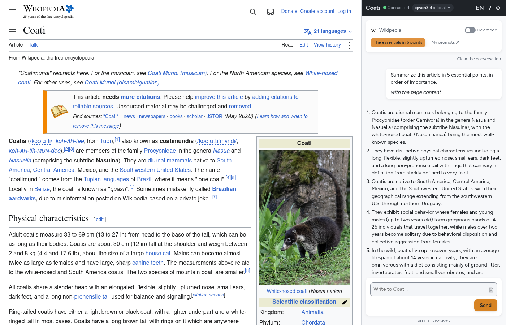

# Coati

Page shown: Wikipedia, "Coati" (text and image under CC BY-SA). Answer generated locally by
`llama3.2` through Ollama.

A companion in the browser: a side panel that answers questions, summarizes the page or video
you're looking at, and reworks text you select — using a model of your choice. Your API keys and
credentials are held by a local program running on `127.0.0.1`, never inside the extension.

Two pieces:

- **`extension/`** — the Chromium/Firefox extension (Manifest V3). It never calls an AI provider
  directly, and holds no credential.
- **`broker/`** — a small server that runs on your own machine, listens on `127.0.0.1` only,
  holds the configuration, and talks to the model. The extension talks to it over a WebSocket.

The contract between the two is fixed in [`docs/PROTOCOL.md`](docs/PROTOCOL.md). Design
decisions and why they were made: [`docs/DECISIONS.md`](docs/DECISIONS.md).

## Why a local broker

An extension's storage isn't encrypted on disk, and an extension is exposed to every page the
user visits. Putting credentials somewhere else — a local process the browser can only talk to,
never read from — takes the secret out of that blast radius. The cost: a recent Chrome
restriction that gates `fetch` to `127.0.0.1` behind a user permission a service worker can't
request itself. WebSockets still escape it, which is why that's the transport — see
`docs/PROTOCOL.md`.

## Status

Version 0.1.0, in public testing. Executables aren't signed by Apple or Microsoft yet (see
"Unsigned binaries" in [docs/INSTALL.md](docs/INSTALL.md)), and the extension isn't on the
Chrome Web Store or AMO yet — it loads in developer mode. File feedback via
[GitHub Issues](https://github.com/CARL-Bouvet/coati/issues).

## Quick start

1. Install the local program — see [docs/INSTALL.md](docs/INSTALL.md) (Linux, macOS, Windows).
2. Load the extension unpacked in your browser (Chrome/Brave/Edge: developer mode; Firefox: see
   [docs/INSTALL.md](docs/INSTALL.md) — merged into INSTALL).
3. Pick a model. Recommended for a first try: [Ollama](https://ollama.com), fully local —
   `ollama pull llama3.2` (~2 GB), then select **Ollama (local)** in the extension's settings.
   A Claude API key or any OpenAI-compatible endpoint also works.
4. Click the Coati icon and ask about the page; the model reads it when your question needs it.

## Docs

- [docs/PROTOCOL.md](docs/PROTOCOL.md) — the extension ↔ broker contract.
- [docs/ARCHITECTURE.md](docs/ARCHITECTURE.md) — how the pieces fit together.
- [docs/INSTALL.md](docs/INSTALL.md) — install, uninstall, troubleshooting.
- [docs/DECISIONS.md](docs/DECISIONS.md) — design decisions and why.
- [docs/ROADMAP.md](docs/ROADMAP.md) — what's next, help wanted.
- [SECURITY.md](SECURITY.md) — threat boundary, reporting a vulnerability.

## License

AGPL-3.0 — see [`LICENSE`](LICENSE). The Coati name and logo are not covered by the AGPL license.

The code is open because that's the only way to make verifiable what Coati promises: page
content doesn't leave your machine unless you chose a remote model. Several competing extensions
promised the same thing in writing and were disproved by traffic analysis — the difference here
is that you can read the code instead of taking our word for it.

## Interface languages

The interface is available in English, French, and Simplified Chinese. The Chinese interface is
machine-translated and awaits review by a native speaker.
中文界面由机器翻译生成，尚待母语者审校。
