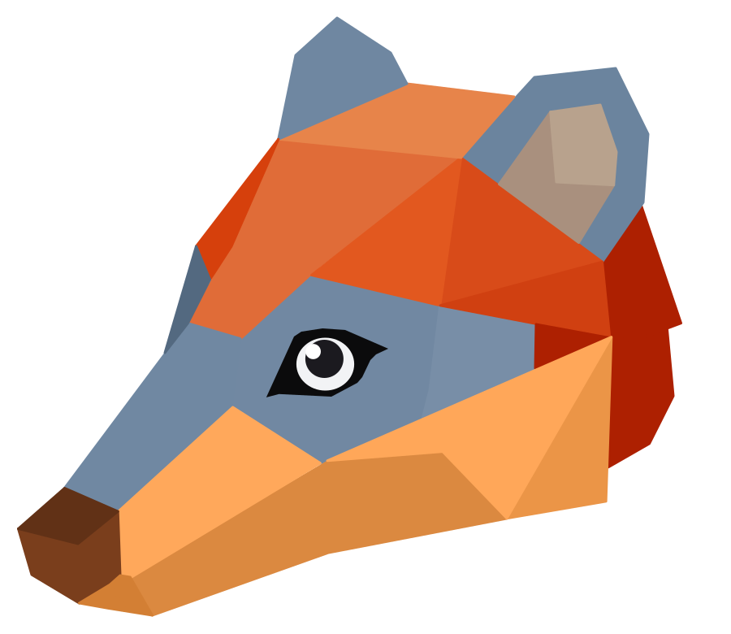

# Coati

Coati is a virtual assistant that lives in a side panel of your browser. Plug in your own AI
model, on your computer (Ollama, LM Studio) or online, and get in-depth web searches, summaries
of articles and YouTube videos, and more.

Coati has only been tested on Linux so far. Reports from macOS and Windows are welcome.

## Install

1. Download the local program and the extension from the
   [latest release](https://github.com/CARL-Bouvet/coati/releases/latest), then follow
   [docs/INSTALL.md](docs/INSTALL.md).
2. Load the extension in Chrome, Brave, Edge or Chromium (developer mode), or in Firefox as a
   temporary add-on.
3. Click the Coati icon or press `Alt+Shift+C`. A guided tour opens the first time, and the
   settings walk you through connecting a model on your computer or an online one.

## Choosing a model

Coati recommends no model: the right one depends on your hardware, and the settings page shows
what your machine can run. Ollama ([library](https://ollama.com/search)) and LM Studio (its
Discover tab) each offer a catalog; [Hugging Face](https://huggingface.co/models?library=gguf)
has many more.

Free online models may keep what you send them. Check the provider's privacy settings before
sending anything confidential.

## Why a local program

An extension's storage is not encrypted on disk, and an extension is exposed to every page you
visit. Coati keeps your API keys in a small program on your own computer, which listens on
`127.0.0.1` only. The extension talks to it over a WebSocket and holds no credential. The
contract between the two is [`docs/PROTOCOL.md`](docs/PROTOCOL.md).

## Privacy and security

Coati has no server of its own and sends no telemetry. Page content leaves your computer only
when you use an online model. Coati never reads password fields, and passes page text to the
model as data. On a page, it only reads and highlights: it never clicks, types, pays, sends,
deletes, publishes or signs in. The local program accepts only the paired extension. Details,
and how to report a vulnerability, are in [SECURITY.md](SECURITY.md).

## Contributing

Bug reports and tests on other systems, browsers and models help most. Open an issue with one of
the [templates](https://github.com/CARL-Bouvet/coati/issues/new/choose), or pick one labelled
[help wanted](https://github.com/CARL-Bouvet/coati/labels/help%20wanted).
[CONTRIBUTING.md](CONTRIBUTING.md) explains how to run the tests and the UI lab.

## Docs

- [docs/INSTALL.md](docs/INSTALL.md): install, uninstall, troubleshooting.
- [docs/ARCHITECTURE.md](docs/ARCHITECTURE.md): how the pieces fit together.
- [docs/PROTOCOL.md](docs/PROTOCOL.md): the extension ↔ local program contract.
- [docs/DECISIONS.md](docs/DECISIONS.md): design decisions and why.
- [docs/ROADMAP.md](docs/ROADMAP.md): what's next.
- [SECURITY.md](SECURITY.md): threat boundary, reporting a vulnerability.

## License

AGPL-3.0, see [`LICENSE`](LICENSE). The Coati name and logo are not covered by the AGPL.

## Interface languages

English, French and Simplified Chinese. The Chinese interface is machine-translated and has not
been reviewed by a native speaker yet.
中文界面由机器翻译生成，尚待母语者审校。
