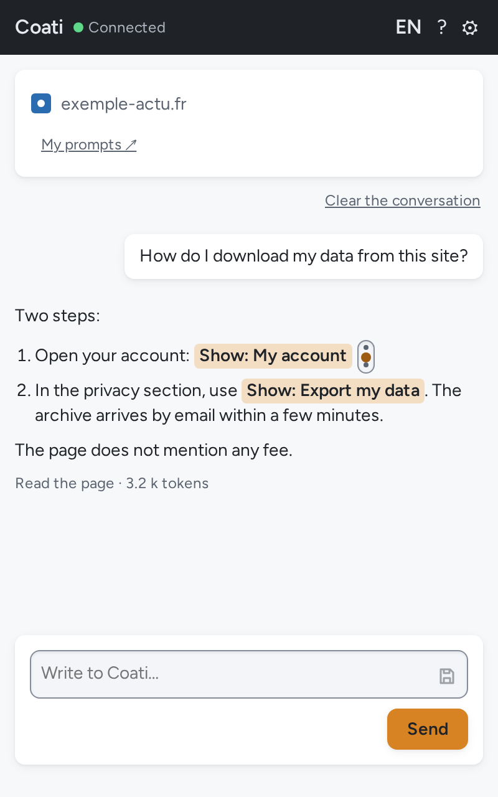
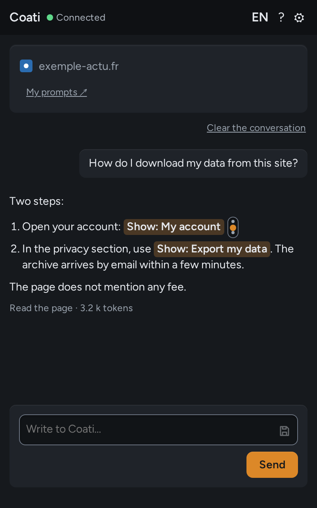
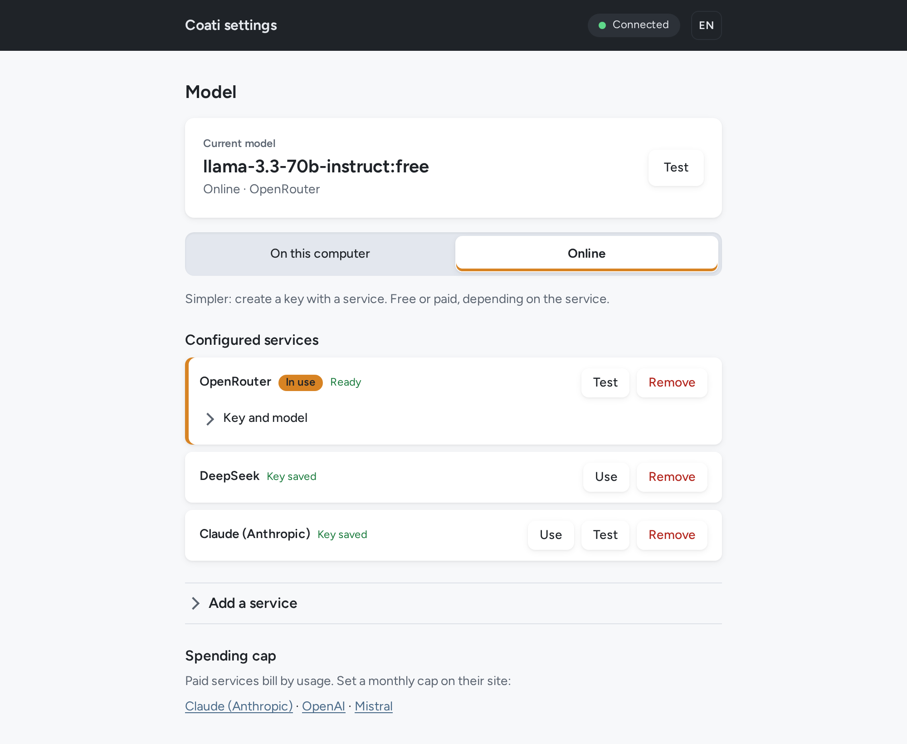

# Coati

A coati pokes its nose into everything. This one pokes into the pages you're reading — only when
you ask.

It's a browser side panel that talks to your own AI model. Ask a question; Coati reads the page if
it needs to, shows you what it read, and answers. No cloud relay, no background activity.

- **Reads only when needed.** The model asks for the page when your question needs it, and every
  answer shows how much it read (or that it did not read the page).
- **Your model, local or online.** Ollama, LM Studio, Claude, OpenAI, Mistral, OpenRouter or any
  OpenAI-compatible address. Coati ships no AI.
- **Show.** Coati points at the element on the page; you click it.
- **Web search** in your browser's own engine, in a visible tab, with sources and checked links.
- **Ready-made prompts** you can set per site.

## Help wanted

Coati has only been tested on Linux. If you're on **macOS or Windows**, try the install and open an
issue when something breaks — the [issue templates](https://github.com/CARL-Bouvet/coati/issues/new/choose)
ask the right questions. Same if you run a local model through an OpenAI-compatible address (LM
Studio, llama.cpp server, vLLM…), use Firefox, or can review the Chinese interface. See
[CONTRIBUTING.md](CONTRIBUTING.md) for how.

## Quick start

1. Install the local program: [docs/INSTALL.md](docs/INSTALL.md) (Linux, macOS, Windows).
2. Load the extension unpacked (Chrome, Brave, Edge, Chromium: developer mode; Firefox: see
   [docs/INSTALL.md](docs/INSTALL.md)).
3. Pick a model (below) in Coati's settings.
4. Click the Coati toolbar icon (or press `Alt+Shift+C`) and ask about the page.

## Which model

There is no single right model: it depends on your machine. For a local model with
[Ollama](https://ollama.com), Coati's setup guide reads your graphics card's memory and recommends
the largest of these that fits in it (without a graphics card, the smallest):

| Model | Download |
|---|---|
| `qwen3.5:2b` | 2.7 GB |
| `qwen3.5:4b` | 3.3 GB |
| `qwen3:8b` | 5.2 GB |
| `qwen3.5:9b` | 6.6 GB |
| `gemma4:12b` | 7.7 GB |

A model that does not fit in graphics memory still works, but slowly. A summary of a page, an
article or a YouTube video works well with a small model.

For multi-step web search, use an online model: Claude, GPT, Mistral… or free ones via
[OpenRouter](https://openrouter.ai). Free models may keep what you send.

## Why a local program

An extension's storage is not encrypted on disk, and an extension is exposed to every page you
visit. Coati keeps your API keys and credentials in a small program on your own machine, which
listens on `127.0.0.1` only. The extension talks to it over a WebSocket and holds no credential.
The contract between the two is [`docs/PROTOCOL.md`](docs/PROTOCOL.md).

## Privacy & security

- Nothing goes through our servers, and there is no telemetry. Page content leaves your machine
  only if you chose an online model.
- Password field values are never read. Page text is treated as data, never as instructions, and
  Coati never pays, sends, deletes, publishes or signs in.
- The local program accepts only the paired extension, on `127.0.0.1`. Details and how to report
  a vulnerability: [SECURITY.md](SECURITY.md).

## Docs

- [docs/INSTALL.md](docs/INSTALL.md): install, uninstall, troubleshooting.
- [docs/ARCHITECTURE.md](docs/ARCHITECTURE.md): how the pieces fit together.
- [docs/PROTOCOL.md](docs/PROTOCOL.md): the extension ↔ local program contract.
- [docs/DECISIONS.md](docs/DECISIONS.md): design decisions and why.
- [docs/ROADMAP.md](docs/ROADMAP.md): what's next, help wanted.
- [SECURITY.md](SECURITY.md): threat boundary, reporting a vulnerability.

Feedback: [GitHub Issues](https://github.com/CARL-Bouvet/coati/issues).

## License

AGPL-3.0, see [`LICENSE`](LICENSE). The Coati name and logo are not covered by the AGPL license.
The code is open so you can check what Coati promises instead of taking our word for it.

## Interface languages

English, French and Simplified Chinese. The Chinese interface is machine-translated and awaits
review by a native speaker.
中文界面由机器翻译生成，尚待母语者审校。
